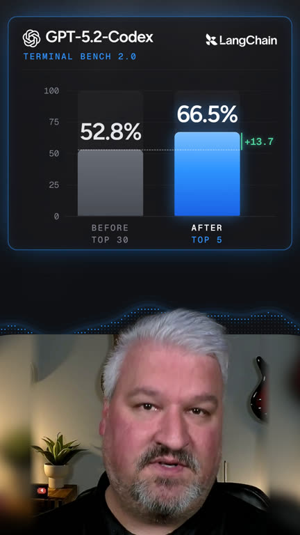
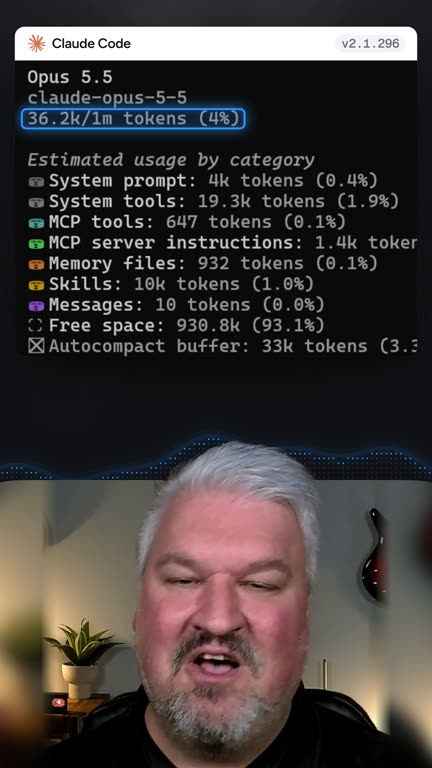
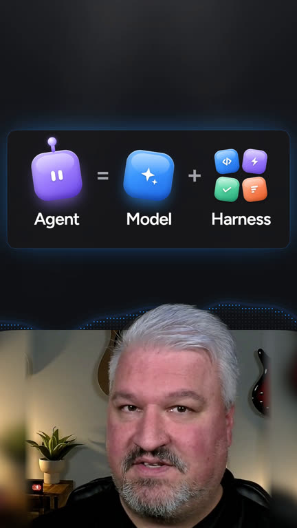
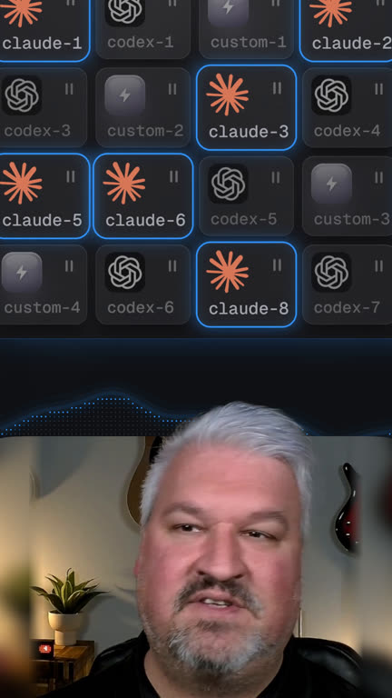
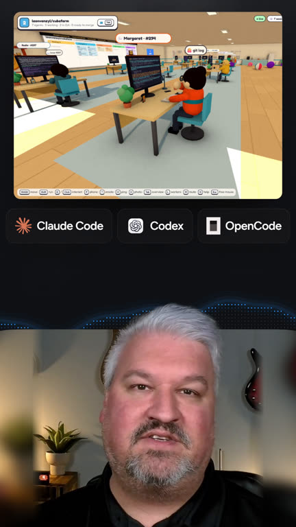

# Publishing package

The full video every Short links to: **"Harness Engineering: Make Any Coding Agent 10x Better"**, https://www.youtube.com/watch?v=z1EaBe9oIME. It's the live YouTube title, checked on 14 October 2026; the file name says "The 3 Levels of Harness Engineering (Beginner to Pro)". If you rename the video, update the 🎬 lines.

## Short 01: same-model-10x-score  (file: edit/short-01_same-model-10x-score/final.mp4)
**Thumbnail** (short-01_same-model-10x-score/thumbnail.jpg, from 38.033 s: the Terminal Bench 2.0 chart, the same model going from 52.8% to 66.5%, above your head pop-out). The YouTube thumbnail and the Instagram cover; on TikTok, upload it as the cover or pick the frame at 38.033 s.



### YouTube Shorts
**Title**
```
Same Model, 10x the Score: The Hidden AI Bottleneck
```

**Description**
```
Changing only the coding harness took Grok Code Fast 1 from 6.7% to 68.3%, and LangChain lifted GPT-5.2-Codex from 52.8% to 66.5% on Terminal Bench 2.0.

🎁 Get the resources from this video + my free AI builder course: https://skool.com/leonvanzyl

🚀 Go deeper inside Agentic Labs: AI coding courses, live Q&A, weekly challenges, and direct access to me: https://skool.com/agentic-labs

#HarnessEngineering #LangChain #AICoding
```
**Related video:** "Harness Engineering: Make Any Coding Agent 10x Better" (https://www.youtube.com/watch?v=z1EaBe9oIME)

### TikTok
**Caption**
```
Same AI model, 10x the score. The hidden bottleneck isn't what you think.
Grok Code Fast 1 went from 6.7% to 68.3% and GPT-5.2-Codex from 52.8% to 66.5% on Terminal Bench 2.0. The model never changed.

🎬 Watch the full video on YouTube: "Harness Engineering: Make Any Coding Agent 10x Better" (link in bio)

#HarnessEngineering #LangChain #AICoding #CodingTok
```

### Instagram Reels
**Caption**
```
Same AI model, 10x the score. The hidden bottleneck isn't the model you pick.

Can Bölük took Grok Code Fast 1 from 6.7% to 68.3% on his coding benchmark, just by changing how its edit tool works.

LangChain kept GPT-5.2-Codex fixed and still climbed from 52.8% to 66.5% on Terminal Bench 2.0 with a better coding agent harness.

🎬 Watch the full video on YouTube: "Harness Engineering: Make Any Coding Agent 10x Better" (link in bio)

#HarnessEngineering #LangChain #AICoding #AIAgents
```

## Short 02: claude-code-30k-tokens  (file: edit/short-02_claude-code-30k-tokens/final.mp4)
**Thumbnail** (short-02_claude-code-30k-tokens/thumbnail.jpg, from 5.533 s: your real Claude Code /context breakdown with the 36.2K total ringed, above your head pop-out). The YouTube thumbnail and the Instagram cover; on TikTok, upload it as the cover or pick the frame at 5.533 s.



### YouTube Shorts
**Title**
```
The Hidden 30K Tokens Claude Code Uses Before You Type
```

**Description**
```
Claude Code's harness fills about 30,000 tokens of context before your first message. On a local model with a 32K window, that's 94% gone. SMOL Coder needs about 1,400.

🎁 Get the resources from this video + my free AI builder course: https://skool.com/leonvanzyl

🚀 Go deeper inside Agentic Labs: AI coding courses, live Q&A, weekly challenges, and direct access to me: https://skool.com/agentic-labs

#ClaudeCode #LocalLLM #ContextWindow
```
**Related video:** "Harness Engineering: Make Any Coding Agent 10x Better" (https://www.youtube.com/watch?v=z1EaBe9oIME)

### TikTok
**Caption**
```
Claude Code burns 30,000 tokens before you even type. Here's why that kills local models.
Local LLMs on Ollama often get a 32K context window. My SMOL Coder harness needs about 1,400 tokens: no MCP, no sub-agents.

🎬 Watch the full video on YouTube: "Harness Engineering: Make Any Coding Agent 10x Better" (link in bio)

#ClaudeCode #LocalLLM #Ollama #CodingTok
```

### Instagram Reels
**Caption**
```
Claude Code uses about 30,000 tokens before you even type. Here's why that kills local models.

Local models on consumer hardware often run with a 32K or 64K context window. Claude Code's harness alone would fill a 32K window to 94%.

So I built SMOL Coder, a coding harness for open-weight models: a short system prompt, eight tools, no MCP and no sub-agents. About 1,400 tokens in all.

🎬 Watch the full video on YouTube: "Harness Engineering: Make Any Coding Agent 10x Better" (link in bio)

#ClaudeCode #LocalLLM #Ollama #OpenSource
```

## Short 03: what-is-an-ai-agent  (file: edit/short-03_what-is-an-ai-agent/final.mp4)
**Thumbnail** (short-03_what-is-an-ai-agent/thumbnail.jpg, from 10.917 s: the "Agent = Model + Harness" equation above your head pop-out). The YouTube thumbnail and the Instagram cover; on TikTok, upload it as the cover or pick the frame at 10.917 s.



### YouTube Shorts
**Title**
```
The Truth About AI Agents (It's Not Just the Model)
```

**Description**
```
What an AI agent really is: the model (Claude Opus, Fable, GPT-6) plus the harness around it, with the rules, tools and checks like tests, lint and type checks.

🎁 Get the resources from this video + my free AI builder course: https://skool.com/leonvanzyl

🚀 Go deeper inside Agentic Labs: AI coding courses, live Q&A, weekly challenges, and direct access to me: https://skool.com/agentic-labs

#AIAgents #HarnessEngineering #LLM
```
**Related video:** "Harness Engineering: Make Any Coding Agent 10x Better" (https://www.youtube.com/watch?v=z1EaBe9oIME)

### TikTok
**Caption**
```
Everyone says "AI agent", but what actually is one? The truth is simpler than you think.
An agent is the model (Claude Opus, Fable, GPT-6) plus the harness: the rules, tools and checks that turn an LLM into a coding agent.

🎬 Watch the full video on YouTube: "Harness Engineering: Make Any Coding Agent 10x Better" (link in bio)

#AIAgents #HarnessEngineering #LLM #TechTok
```

### Instagram Reels
**Caption**
```
Everyone says "AI agent". The truth about what one actually is might surprise you.

The model is the brain: Claude Opus, Fable or GPT-6.

The harness is the environment it works in: the rules it follows, the tools it can use, and the checks it has to pass, like test suites, lint and type checks.

🎬 Watch the full video on YouTube: "Harness Engineering: Make Any Coding Agent 10x Better" (link in bio)

#AIAgents #HarnessEngineering #LLM #AICoding
```

## Short 04: software-factory-20-agents  (file: edit/short-04_software-factory-20-agents/final.mp4)
**Thumbnail** (short-04_software-factory-20-agents/thumbnail.jpg, from 13.950 s: the Agent Swarm pool with the Claude Code workers lit, above your head pop-out). The YouTube thumbnail and the Instagram cover; on TikTok, upload it as the cover or pick the frame at 13.950 s.



### YouTube Shorts
**Title**
```
The Secret to Running 20 AI Coding Agents at Once
```

**Description**
```
A software factory keeps an agent swarm of 10 or 20 coding agents, from Claude Code and Codex to your own harness, and hands each new task to the next free agent.

🎁 Get the resources from this video + my free AI builder course: https://skool.com/leonvanzyl

🚀 Go deeper inside Agentic Labs: AI coding courses, live Q&A, weekly challenges, and direct access to me: https://skool.com/agentic-labs

#SoftwareFactory #ClaudeCode #AIAgents
```
**Related video:** "Harness Engineering: Make Any Coding Agent 10x Better" (https://www.youtube.com/watch?v=z1EaBe9oIME)

### TikTok
**Caption**
```
How do you run 20 AI coding agents at once without chaos? The secret is a software factory.
Claude Code and Codex agents wait in a swarm. The factory gives each new task to the next free agent, and waits when they're all busy.

🎬 Watch the full video on YouTube: "Harness Engineering: Make Any Coding Agent 10x Better" (link in bio)

#SoftwareFactory #ClaudeCode #Codex #AIAgents #CodingTok
```

### Instagram Reels
**Caption**
```
The secret to running 20 AI coding agents at once without chaos.

A software factory keeps an agent swarm in the background: Claude Code agents, Codex agents, even your own coding harness.

Whenever a project needs a change, the factory hands the task to the next free agent. When every agent is busy, it waits.

🎬 Watch the full video on YouTube: "Harness Engineering: Make Any Coding Agent 10x Better" (link in bio)

#SoftwareFactory #ClaudeCode #Codex #AIAgents
```

## Short 05: agent-swarm-in-3d  (file: edit/short-05_agent-swarm-in-3d/final.mp4)
**Thumbnail** (short-05_agent-swarm-in-3d/thumbnail.jpg, from 13.267 s: your real 3D office with the Claude Code, Codex and OpenCode logos, above your head pop-out). The YouTube thumbnail and the Instagram cover; on TikTok, upload it as the cover or pick the frame at 13.267 s.



### YouTube Shorts
**Title**
```
My AI Agent Swarm Works in 3D (Insane to Watch)
```

**Description**
```
cubefarm turns a coding agent swarm into a 3D office: Claude Code, Codex and OpenCode agents work GitHub issues from a Kanban board and open real pull requests.

🎁 Get the resources from this video + my free AI builder course: https://skool.com/leonvanzyl

🚀 Go deeper inside Agentic Labs: AI coding courses, live Q&A, weekly challenges, and direct access to me: https://skool.com/agentic-labs

#AgentSwarm #ClaudeCode #AICoding
```
**Related video:** "Harness Engineering: Make Any Coding Agent 10x Better" (https://www.youtube.com/watch?v=z1EaBe9oIME)

### TikTok
**Caption**
```
My AI agent swarm works in a 3D office, and it's insane to watch.
Every agent runs a real coding harness, Claude Code or Codex, and works GitHub issues from a Kanban board until it's built, tested and verified.

🎬 Watch the full video on YouTube: "Harness Engineering: Make Any Coding Agent 10x Better" (link in bio)

#AgentSwarm #ClaudeCode #AICoding #CodingTok
```

### Instagram Reels
**Caption**
```
No one said an agent harness should be boring. My AI agent swarm works in 3D, and it's insane to watch.

Every agent in the office runs a real coding harness: Claude Code, Codex and more. Walk up to a monitor and you can see it running Claude Opus.

The whiteboard is a Kanban board hooked up to real GitHub issues, and every card jumps to its actual pull request.

🎬 Watch the full video on YouTube: "Harness Engineering: Make Any Coding Agent 10x Better" (link in bio)

#AgentSwarm #ClaudeCode #AICoding #AIAgents
```
